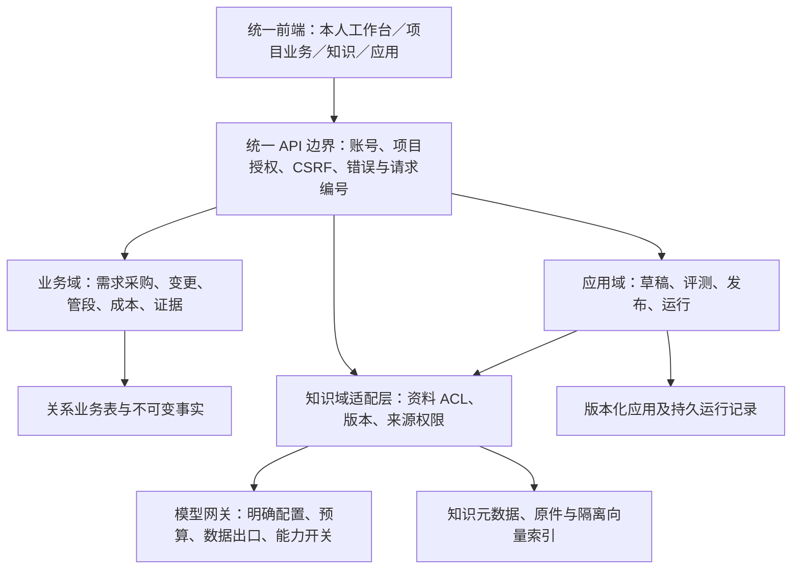

# 密灯双版本差异与合并技术方案

> 本文保留执行前的评估与批准基线；当前交付状态见 `../项目状态.md` 和整合分支Git记录。

形成日期：2026-11-06。状态：评估与方案已交付，待用户明确“执行”；尚未合并、改造、提交、推送或部署。

## 1. 推荐结论

可以合并优化。推荐以本机版已验收的项目协同业务为功能基础，复用 GitHub 版的知识库、检索问答、应用画布和运维能力，形成一个入口、一套账号与项目权限、多个业务模块的密灯。合并应按模块移植及适配，不能直接覆盖文件或把两个应用挂到同一个地址就算完成。

- 专业判断：两者同源、技术栈兼容，主要整合成本在身份、权限、数据语义和发布验证，而非重写知识库。
- 使用人员视角：同一账号处理项目流程、查项目资料、追溯来源，不再切换产品或重复授权；审批仍由具体岗位确认。
- 深层技术判断：必须先统一账号标识及资料访问边界，再接模型和画布，否则“业务页面不可见”仍可能被检索、引用、历史对话或下载绕过。

## 2. 比较对象与证据边界

| 对象 | 本次实际版本 | 说明 |
| --- | --- | --- |
| GitHub 版 | `weiweidounais/mideng`，main，`030ed097acad06fb8461171a2b77331d5d39ed2b` | 2026-11-02 提交；全新拉取到 `/Users/Apple_501/Desktop/数据中台/mideng`，工作区干净 |
| 本机协同版 | `idea-to-launch-kit/projects/密灯` 当前工作区 | 工具包 HEAD 为 `62382b3`，但后续已验收成果大量尚未提交，因此以当前文件哈希为准，不能只拿这个提交号比较 |

本次为真实源码与本地运行核查，不只比较 README。测试使用独立合成数据：GitHub 版 18420，本机版 18421；日常 18410 未用于业务写入。没有复制实际财务资料、借用其他项目凭证、配置付费模型或连接 ERP。

范围内源码统计（`backend/app`、`backend/tests`、`frontend/src`、`scripts` 及依赖清单/锁文件）：63 个同名文件内容一致、8 个同名文件不同、本机独有 99 个、GitHub 独有 7 个。不是全仓文件总数。证据：[source-comparison.json](source-comparison.json)、[原始哈希清单](source-manifest-before.json)。

## 3. 产品与技术差异

| 比较项 | GitHub 版 | 本机协同版 | 合并处理 |
| --- | --- | --- | --- |
| 产品中心 | 企业知识与协同工作台：资料→知识→问答；附项目交接 | 嘉元项目协同中台：项目→版本→责任→执行→证据 | 保留协同为日常主入口，增加知识与应用入口 |
| 身份 | admin/manager 共用管理口令；普通浏览器会话形成 principal，项目另行授权；默认会话 8 小时，换设备需处理身份授权 | 独立账号、项目成员及岗位动作、持久署名；管理员也须遵守具体业务边界 | 采用本机账号体系；旧 principal 不自动当作真实员工 |
| 业务岗位 | 市场、商务、项目经理、设计、采购五类协同岗位 | 扩展质量、工厂、现场、财务等岗位，并检查指定经办人 | 不降级已实现岗位与经办人限制 |
| 采购流程 | 商务交底→设计方案/交付契约→采购验收交付→询价/下单/到货登记；记录原系统凭证 | 设计正式方案→PM提采购需求→采购执行→PM复核数量和约定交期→实际到货→质量验收→商务合同与成本归档 | 采用本机流程；不能把 GitHub 的“交付验收”当作“材料质量验收” |
| 变更 | 需求版本快照、下游 needsReview、重新核对依据，保留订单事实 | 独立变更单、四专业影响、既有批准原件、送达与本人确认、逐对象处置和验证、关闭门禁 | 保留本机完整变更状态机 |
| 管段/手机 | 未发现同等管段生命周期业务模块 | 模板照片、二维码、材料/焊缝/预制/检验/发运/安装/试压、质量门禁、拆并追溯；此前 Mate X5 真机通过 | 保留；本次未新增真机验收结论 |
| 成本与月结 | 无同等会计批次、预检、入账及月结模块；知识库 Excel 检索不是精确财务核算 | 源表解析/映射/预检、整批拦截、显式入账、更正链、实际/承诺/付款/发票分列、月结快照与敏感权限 | 财务维持独立账务事实，不能由问答/画布直接改账或放行 |
| 知识/RAG | 正式导航有知识库、多格式导入、分块/元数据、索引、检索、来源问答、RAG 工作台 | 大部分对应源码仍保留且与 GitHub 一致；当前 `app.pilot:app` 与 pilot 前端有意不开放这些路由和界面，F10 未启用 | 优先复用现有模块，按权限和启用策略适配；不是从零开发 |
| 应用画布 | 开始、检索、生成、条件、模板、输出；草稿/发布版本、评测门禁、运行记录和回滚 | legacy 代码保留，但不属于当前协同正式入口 | 先接规则/模板能力，再以独立开关接模型节点；不允许画布绕业务审批 |
| 数据与任务 | 通用 Entity JSON、legacy Session/Actor、持久导入/问答/应用运行；SQLite/Qdrant 本地，另有 Compose 配置 | 独立 PilotBase 关系表及 pilot_001—010、账号/版本/证据、持久幂等/任务/事件；保留 legacy 存储代码 | 两类领域表先分区保留，通过稳定 ID 和适配层关联，不强制搬成一种 JSON 表 |
| 错误与重试 | 通常 `detail` 错误，协同 expectedRevision CAS；缺少同等通用业务幂等回查机制 | `error.code/message/request_id`、revision CAS、持久幂等键、未知写入结果恢复、分页和 URL 定位 | 以本机协议为外部规范，为知识模块加兼容适配 |
| 安全与发布 | 增加 check-secrets、Git 钩子与 CI 历史扫描、Windows 启动脚本、空白原型种子 | 当前正式入口隔离旧全局知识路由，单独本机验证策略；这些 GitHub 运维改进并未全部迁入 | 吸收扫描与启动支持；不得带回未脱敏原型快照或运行文件 |

两者都尚不能据此宣称：企业实名 SSO 已接通、ERP/MES 写入已完成、正式多人部署已验收、ROI 已验证。本机版全量整板查询此前仍高于建议 2 秒；本次不重复宣称企业性能达标。

## 4. 本次实际验证结果

| 检查 | GitHub 版 | 本机版 |
| --- | --- | --- |
| 全量后端回归 | 167/167 通过 | 333/333 通过，包含部分继承知识模块测试，不能把数量差直接解释为产品质量倍数 |
| 前端 | 7 项原型适配检查通过；TypeScript＋生产构建通过；无独立 lint 脚本 | 28 项 Node 测试＋7 项原型适配检查通过；类型、Lint、生产构建通过 |
| 当前服务真实 HTTP | 23 项初轮断言通过；5 个独立岗位身份，覆盖需求→交底→方案→交付退回重交→采购验收→询价下单→变更拦截→重新核对→到货→决策关闭→JSON 导出；撤权即时拒绝 | 30 项已存证断言通过；新建同一合成项目，采购 archived、管段 completed、变更 closed、财务月结已发布；真实证据 ZIP 哈希和敏感隔离通过 |
| 知识与应用补查 | 真实文档上传、解析、人工复核、原件哈希；规则元数据、Form 切块预览；未发布文档不参与检索；无依据时明确拒答；模板应用评测失败阻断、成功发布、草稿分离、发布回滚均实测 | 正式入口不开放知识模块，本次不借 legacy 测试冒充它在正式入口可用 |
| 实际强杀重启 | 进程强杀再启动，项目/版本/采购/决策/审计事实、原件哈希、应用发布版本读回一致 | 进程强杀再启动，四链状态及财务快照读回一致 |
| 源码保护 | 比较前后清单内全部原文件哈希一致、clone Git 工作区干净 | 比较前后清单内全部原文件哈希一致；原先未提交变更保留，正常 18410 健康 |

证据：[GitHub HTTP](github-http-checks.json)、[本机 HTTP](local-http-checks.json)、[6 项补查及恢复](recovery-checks.json)、[源码保护](preservation-check.json)、[本机证据包](local-evidence-export.zip)，完整命令输出在 `logs/`。

### 未完成的验证，不能写成通过

1. 独立 GitHub 环境未配置 Embedding/LLM/Rerank/Vision，也未安装本地向量引擎。真实上传解析成功，但索引发布任务因缺模型明确失败；问答只验证了“依据不足”的本地返回。真实向量检索、有依据生成、OCR/视觉及模型效果仍待有授权的服务配置后验证。167 项测试中的云 HTTP 替身是契约测试，不是真实模型验收。
2. 浏览器已实际打开两个正式入口并登录，GitHub 知识库截图和双方 DOM 核查已完成；跨日继续时 TaskSpace 32 已不存在，未新建会话绕过恢复规则。因此不声称此次每个节点均已在浏览器点击，完整业务状态流转主要由真实 HTTP 和数据库持久化结果支撑。
3. 本次不含新的手机真机、Docker/云部署、多组织/生产负载验证。Compose 文件存在不代表已经实测部署。

验证脚本曾因将切块 Form 接口当 JSON、从摘要读取分页焊缝、误用不存在的月结详情 GET、比较导出生成时间而失败；依据接口定义修正的是评估脚本，未修改产品来迎合测试。暂停点使用已有状态续跑，未重做或覆盖业务数据；失败日志一并保留。旧导出时间与新导出时间不同不算业务丢失。

## 5. 推荐技术架构

### 5.1 维护源与代码接入

用户确认执行后，在 GitHub `mideng` 的独立集成分支/工作区整理最终产品；以本机当前验收工作树作为业务能力的权威输入，以 GitHub 当前提交作为知识与仓库治理参考。先对本机未提交成果形成可恢复的源码快照与清单，再以产品目录为单位移植；不把整个工具包历史直接合入产品库，不在原工作区丢弃、暂存或提交他人改动。最终提交/推送按用户指令进行。

保留两边已有能力和回归测试。63 个相同文件原则上不重复移植，8 个不同文件逐项评审；其中 legacy `collaboration.py` 的改进只作为兼容及历史读档参考，不替换本机新的 handoff/procurement/change 状态机。GitHub 原型空白种子及安全脚本应优先吸收。

### 5.2 账号、授权和前后端接口

- 统一采用稳定 Account ID、项目 Membership 与岗位动作检查；取消对共享管理口令作为业务人员身份的依赖。知识管理员的权限不自动扩成所有项目资料访问权。
- 不直接挂载 `app.main` 与 `app.pilot` 两个应用：它们有不同登录协议、Cookie（`zhixu_session` / `mideng_pilot_session`）、Actor/Session、配置与存储生命周期。为知识/应用路由显式转换受信任的统一 Actor，并替换相应依赖及所有权校验。
- API 按业务域区分；外部错误统一，知识旧响应通过前端适配器渐进兼容。知识导入/发布/应用执行新增幂等及状态回查；保留现有 CAS、不可变版本和长任务持久化。
- 知识、模型和应用页面按权限显示。前端代码需纳入正式类型/Lint/测试及构建，不能只把旧页面显示出来却继续排除在 pilot 类型检查之外。

### 5.3 资料权限与 AI 边界

知识库、文档及应用增加项目/公司共享范围和 ACL；原件/片段继承来源版本、密级、保留规则。按权限限定检索候选集合或隔离索引；返回来源、读取原件、历史对话引用、应用运行和导出时重新校验当前权限。撤权或资料失效应同步使索引及缓存失效，不能只隐藏导航或只在最终答案里过滤。

财务原件和人员敏感字段默认不进入通用知识库及外部模型；商务采购归档和会计实际入账继续是两个独立事实。AI 首批仅做有来源的资料问答/摘要，不代发正式版、不代下单、不代质量放行、不代财务入账。F10、Embedding、生成、Rerank、Vision分别有配置与开关；真实厂商、endpoint、模型、预算和企业资料出口确认后才启用。

### 5.4 数据兼容与迁移

先保留两套领域表及任务数据的逻辑隔离，逐步在同一后端内整合；不为了统一而重写已验证的成本或版本表。数据库技术选型保持现状，企业部署位置确定后再验证目标数据库和任务部署模式，不能直接套用 GitHub Compose 取代现有运行入口。

先只读盘点与试迁移：保留来源仓库/项目/对象/版本 ID、原件哈希、作者、时间及映射清单。旧 browser principal→Account、旧交付契约→新交付对象、旧 BOM/采购登记→新采购对象均需显式映射和人工核对；无法确认的留历史档案，不自动激活或默认“已质量验收/已财务入账”。原系统凭证只做证据引用，不产生 ERP 写操作。迁移失败可退回完整数据库、原件及必要加密密钥备份。

## 6. 用户确认执行后的实施顺序

| 里程碑 | 工作内容 | 完成标准 |
| --- | --- | --- |
| M1 冻结基线 | 新分支/工作区、完整源码快照、接口与权限映射、迁移演练清单 | 两份原产品可独立恢复，范围内差异有处置结论 |
| M2 统一基础 | 独立账号、项目/资料 ACL、统一入口、错误与幂等适配；先接无需模型的知识管理和规则画布 | 同一账号跨模块；越项目、撤权、下载/历史/导出不能绕权限；现有四链不回退 |
| M3 恢复知识能力 | 导入/分块/元数据/发布任务；在已批准服务下验证索引、检索、问答与来源 | 合成资料真实模型冒烟、来源准确、无依据拒答、超时/失败可恢复；真实资料需满足企业出口限制 |
| M4 迁移与回归 | 旧数据只读试迁移，人工核对并选择激活；完整业务、知识/应用/权限、移动端与恢复回归 | 原件及版本可追溯、无重复订单/入账、无越权；两边已有测试保留且通过 |
| M5 交付评审 | 差异验收、回滚演练、启动/备份说明；企业试点部署另审 | 本机可验收的统一版本及证据；用户核准后才推进真实数据与部署 |

M1—M2不依赖新付费服务；M3涉及真实模型服务配置与用量，模型厂商、费用上限和数据出口是启用前的必要输入。工作量主要取决于旧数据规模、身份能否映射、资料 ACL 粒度与企业部署要求；本次证据不足以给出可靠固定工期或报价。建议先完成基础整合再估算后续，不以省去权限和恢复验收来缩短工期。

## 7. 合并版验收底线

1. 原本机采购流程逐岗位不变；质量不能在未到货时放行，合同金额对非授权人不可见。
2. 变更四专业/批准/本人确认/处置/关闭门禁、管段适用履历和财务精确核算均保留。
3. 使用同一独立账号；项目/知识资料/原件/检索结果/历史会话/应用运行/证据包权限一致，撤权即时生效。
4. 断网、写入响应丢失、并发更新和进程强杀后可恢复，不重复生成订单、入账或发布。
5. 真实模型链路与 mock 契约测试分开报告；没有配置或真实调用时必须标待验。
6. 企业部署、真实业务、性能目标、费用和业务收益分别验收；不把“本机能打开”当作正式上线。

## 8. 当前交付与下一步

本轮只产生 clone、隔离测试数据、评估脚本、证据和这份方案，没有对两份产品源代码实施合并。原正常入口 `http://127.0.0.1:18410/` 保留。模型链路、完整浏览器复验及企业部署的未验范围已列明。

用户明确说“执行”后，按上述推荐方案从 M1 开始。此处等待来自用户指定的“先方案、我说执行再开始”，不是额外的重复审批要求。

收尾核对：本次临时18420/18421服务均已停止且无监听；隔离测试数据与证据保留；正常18410健康。详见[收尾检查](completion-check.json)。
